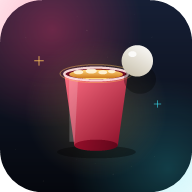

# 🍻 Beer Pong — Mesa Neon

PWA de beer pong solo com visual neon, feita para jogar no celular. Sem build,
sem dependências e sem backend: HTML, CSS e JavaScript puro.



## ✨ Funcionalidades

- **Dois modos**: **Partida real** (3 chances) e **Treino** (rack infinito).
- **6 copos enfileirados na direção do arremesso**, apontando para a bola.
- **Partida real**: cada erro ou borda perde uma chance; ao errar as 3, a partida termina. Os copos **ficam na mesa**.
- **Treino**: os copos **somem** ao acertar e o rack volta quando todos caem.
- **Placar em tempo real**: pontos, precisão, sequência e recorde.
- Física de arremesso com arco, sombra, quique e detecção de borda.
- Mira por arrasto, com retícula acima do dedo para não tapar o alvo.
- Efeitos sonoros sintetizados (Web Audio), vibração e partículas.
- Estatísticas e ajustes salvos no dispositivo (`localStorage`).
- **PWA instalável**, funciona offline e abre em tela cheia.
- Layout mobile-first, safe areas do iPhone, suporte a mouse e teclado.

## 📁 Estrutura

```
.
├── index.html            # telas, HUD e SVG sprite
├── styles.css            # design responsivo mobile-first
├── manifest.json         # manifesto do PWA
├── sw.js                 # service worker (cache offline)
├── js/
│   ├── main.js           # bootstrap, input, loop e registro do SW
│   ├── game.js           # regras dos modos, pontuação e física
│   ├── render.js         # canvas 2D: mesa, copos, bola, mira e efeitos
│   ├── ui.js             # telas, HUD, ajustes e instalação
│   ├── audio.js          # sons sintetizados
│   ├── store.js          # persistência local
│   └── config.js         # constantes (copos, layout, storage)
├── icons/                # ícones PNG (192, 512, maskable, Apple, favicon)
├── tools/
│   ├── serve.ps1         # servidor local em PowerShell (sem Node/Python)
│   └── make-icons.ps1    # regenera os ícones
├── render.yaml           # deploy automático no Render
├── LICENSE               # licença MIT
└── README.md
```

## ▶️ Rodar localmente

O service worker exige `http://localhost` ou HTTPS (não funciona abrindo o
`index.html` direto). Escolha uma opção:

**Com Node:**

```bash
npx serve .
```

**Com Python:**

```bash
python -m http.server 4173
```

**Com PowerShell (Windows, sem instalar nada):**

```powershell
powershell -ExecutionPolicy Bypass -File tools/serve.ps1
```

Depois abra <http://localhost:4173>.

> Dica: no Chrome/Edge, abra o DevTools → aba *Application* → *Manifest* e
> *Service Workers* para validar a instalação e o cache.

## 🚀 Publicar no GitHub

No terminal, dentro da pasta do projeto:

```bash
git init
git add .
git commit -m "feat: Beer Pong PWA solo"
git branch -M main
git remote add origin https://github.com/Wolleebob/Beer-pong.git
git push -u origin main
```

Crie o repositório vazio em <https://github.com/new> antes do `push` (sem
README, sem .gitignore). Se o Git não estiver instalado, baixe em
<https://git-scm.com/downloads>.

Para publicar pelo navegador, abra a pasta do projeto, selecione os arquivos
**de dentro dela** (incluindo as pastas `js/` e `icons/`) e arraste para o
GitHub. Não arraste a pasta do projeto inteira: o `index.html` precisa ficar
na raiz do repositório para o GitHub Pages encontrar o site.

### GitHub Pages

1. No repositório, abra **Settings → Pages**.
2. Em **Source**, escolha **Deploy from a branch**.
3. Selecione a branch **main** e a pasta **/ (root)**.
4. Salve e aguarde o deploy. O jogo fica em
   <https://wolleebob.github.io/Beer-pong/>.

Depois de atualizar os arquivos, faça um hard refresh (`Ctrl+Shift+R`) para
o service worker baixar a versão nova.

## ☁️ Publicar no Render

### Opção A — Blueprint (usa o `render.yaml`)

1. Envie o projeto para o GitHub (passos acima).
2. Acesse <https://dashboard.render.com/blueprints> → **New Blueprint Instance**.
3. Conecte o repositório `beer-pong`. O Render lê o `render.yaml` e cria o
   serviço estático automaticamente.
4. Clique em **Apply** e aguarde o deploy.

### Opção B — Dashboard

1. <https://dashboard.render.com> → **New +** → **Static Site**.
2. Conecte o repositório do GitHub.
3. Preencha:
   - **Name:** `beer-pong` (ou outro)
   - **Branch:** `main`
   - **Build Command:** *(deixe vazio)*
   - **Publish Directory:** `.`
4. **Create Static Site**.

O Render entrega HTTPS de graça, requisito para o PWA. Cada `git push` na
branch `main` dispara um novo deploy.

### Variáveis de ambiente

Nenhuma. O projeto é 100% estático.

## 📲 Instalar como app

- **Android/Chrome:** menu ⋮ → *Instalar app* (ou o botão **Instalar
  aplicativo** no menu do jogo).
- **iPhone/Safari:** botão *Compartilhar* → *Adicionar à Tela de Início*.
- **Desktop:** ícone de instalação na barra de endereço.

Depois de instalado, o jogo abre sem barra de navegador e funciona offline.

## 🎮 Como jogar

1. Escolha **Partida real** ou **Treino** no menu.
2. Arraste o dedo na mesa para posicionar a mira.
3. Solte para arremessar. A mira fica alguns pixels acima do dedo.
4. Acerte um dos 6 copos alinhados na direção do arremesso para marcar 1 ponto.
5. **Partida real:** você tem 3 chances. Cada erro ou borda perde uma chance; ao errar as 3, a partida termina. Os copos ficam na mesa.
6. **Treino:** arremessos infinitos. Os copos somem ao acertar e o rack é recarregado quando todos caem.
7. Acertos seguidos aumentam a sequência; errar (ou acertar só a borda) zera.

No computador: arraste com o mouse ou use as setas + espaço/Enter.

## 🎨 Personalizar

- Cores: variáveis no topo de `styles.css` e gradientes em `js/render.js`.
- Quantidade e espaçamento dos copos: `CUP_COUNT`, `CUP_RADIUS`,
  `CUP_SPACING`, `RACK_Z` e `MATCH_LIVES` em `js/config.js`.
- Nome/ícones: `manifest.json` e a pasta `icons/`.
- Para regenerar ícones: `powershell -ExecutionPolicy Bypass -File tools/make-icons.ps1`.

## ⚠️ Aviso

Conteúdo para maiores de 18 anos. Beba com moderação e nunca dirija depois de
beber. O jogo funciona perfeitamente com água — a diversão é a mira. 🏓

## 📄 Licença

MIT. Use, altere e compartilhe.
